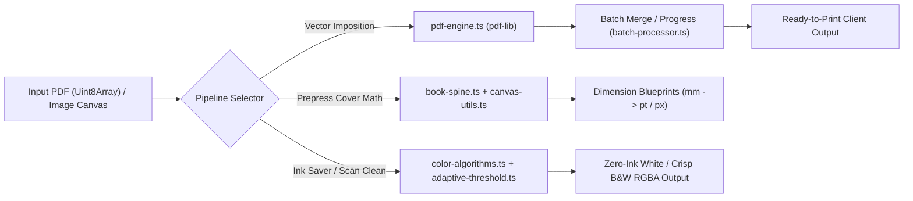

# ImpressReady — Zero-Upload PDF Imposition & Canvas Prepress Engine

> **Portfolio Showcase Notice:** This repository is a **curated public engineering showcase** extracted from the core client-side engine of **[ImpressReady](https://impressready.com)** (`https://impressready.com`). The full SaaS web application (React UI, Firebase Authentication, static tooling pages, and Lemon Squeezy licensing integration) remains in a private repository. All PDF manipulation, pixel-level color transformation, and mathematical imposition modules below execute 100% locally in TypeScript without server uploads.

[](./tsconfig.json)
[](./tests)
[](./src/lib/pdf-engine.ts)
[](./src)

---

## Architecture Overview

Every document transformation runs client-side in memory (`Uint8Array` PDF buffers and RGBA `Uint8ClampedArray` pixel pipelines) so user PDFs and scanned IDs/documents never leave the browser.



---

## Core Modules

### 1. Vector PDF Imposition & Prepress Generation (`src/lib/pdf-engine.ts`)
Built directly on `pdf-lib` primitives (no headless browser or server rasterization required):
- **Saddle-Stitch Booklet Imposition (`createBookletPdf`):** Pads arbitrary page counts to multiples of 4 and pairs front/back spreads onto landscape A4 sheets for duplex folding.
- **N-Up & Ruled Speaker Handouts (`createNUpPdf`):** Supports `2/4/6/8/9-up` grids plus a dedicated `handout_3up` layout pairing 3 slides per A4 portrait sheet alongside ruled note lines.
- **Brochure Fold Imposition (`createBrochureFoldPdf`):** Arranges 4-panel `bifold` and 6-panel `trifold_c` / `trifold_z` spreads on A4 or A3 landscape sheets with optional fold guides.
- **Duplex Binding Gutter & Splitters (`createGutterMarginPdf`, `splitPdfByColor`, `createAutoRotatePdf`, `createReverseOrderPdf`, `createPrintStampPdf`):** Alternating left/right margins for double-sided spiral or ring binding, color vs. monochrome sheet separation, PDF rotation matrix normalization (`/Rotate`), and low-toner outline watermarks.
- **Pure Vector Prepress Templates (`createTemplatePdf`, `createBinderSpinePdf`):** Procedurally draws A4 vector stationery (`graph`, `dotgrid`, `music`, `cornell`, `hexagonal`, `isometric`, handwriting guides) and customizable lever-arch binder spine sheets.
- **Bug Fix Discovered via Testing:** `pdf-lib`'s `embedPdf(srcDoc)` defaults to `indices = [0]`, silently omitting subsequent pages on multi-page imposition calls. Extracting `embedAllPdfPages(destDoc, srcDoc)` (`srcDoc.getPageIndices()`) ensures complete multi-page embedding across Booklet, N-Up, Gutter, Smart Crop, and Brochure workflows.

### 2. Pixel-Level Toner Saving & Adaptive Scan Restoration
- **Dark-Mode Ink Saver (`src/lib/color-algorithms.ts` — `processInkSaver`):** Evaluates ITU-R BT.601 luminance ($0.299R + 0.587G + 0.114B$) alongside HSV color saturation so dark slide backgrounds flatten to zero-ink white (`#FFFFFF`) while preserving saturated photos and charts, reporting `estimatedInkSavedPercent`.
- **Adaptive Shadow Thresholding (`src/lib/adaptive-threshold.ts` — `cleanDocumentScan`):** Uses local sliding-window brightness averaging across uneven mobile camera scans (`crisp_bw`, `color_clean`, `pencil_boost`) to separate ink strokes from shaded paper without blowing out text.
- **Safe Canvas & Pure Mono (`src/lib/canvas-utils.ts`):** Exact PostScript point conversions (`mmToPt`), DPI pixel sizing (`mmToPx`), browser max-pixel-area guards (`calculateSafeDisplayScale`), and strict black/white thresholding (`processPureBlackCanvas`).

### 3. Book Spine & Full Wrap Cover Calculator (`src/lib/book-spine.ts`)
Extracted from the interactive prepress calculator tool into a deterministic TypeScript domain module supporting 8 paper caliper presets (`offset_80` through `glossy_170`):
- **Softcover (PUR):** `Math.max(3, sheets * caliperMm + 0.6)` mm spine, `0` mm hinge.
- **Hardcover:** `Math.max(7, sheets * caliperMm + 1.2 + 4.0)` mm spine with `8` mm cajeado hinges on each side plus perimeter bleed calculation.

---

## Repository Structure

```text
impressready-pdf-engine/
├── src/
│   ├── index.ts                     # Public barrel exports
│   ├── types/index.ts               # Print, imposition, fold, and image-processing interfaces
│   └── lib/
│       ├── adaptive-threshold.ts    # Local box-window scan cleaner (cleanDocumentScan)
│       ├── batch-processor.ts       # Multi-PDF merge, ZIP helper & sequential batch runner
│       ├── book-spine.ts            # Pure hardcover/softcover wrap geometry & paper calipers
│       ├── canvas-utils.ts          # mm->pt, mm->px, pixel-cap scaling & monochrome filters
│       ├── color-algorithms.ts      # Luminance/saturation ink-saver pixel pipeline
│       └── pdf-engine.ts            # Pure pdf-lib imposition & vector generator suite
└── tests/
    ├── helpers/mock-canvas.ts       # Lightweight RGBA Uint8ClampedArray Canvas 2D mock for Node
    ├── canvas-and-book-spine.test.ts
    ├── color-and-scan-algorithms.test.ts
    └── pdf-imposition-and-prepress.test.ts
```

---

## Verification

Unit tests run purely in Node using `vitest`: PDF imposition tests construct real binary PDFs with `pdf-lib`, and Canvas 2D pixel filters execute end-to-end against an in-memory RGBA mock buffer:

```bash
npm install
npm run typecheck   # Strict TypeScript compilation check
npm test            # Vitest suite (13 unit tests across 3 test files)
```
